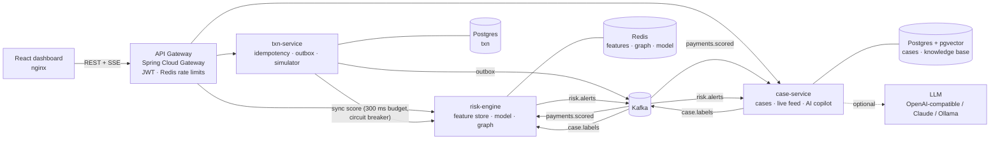
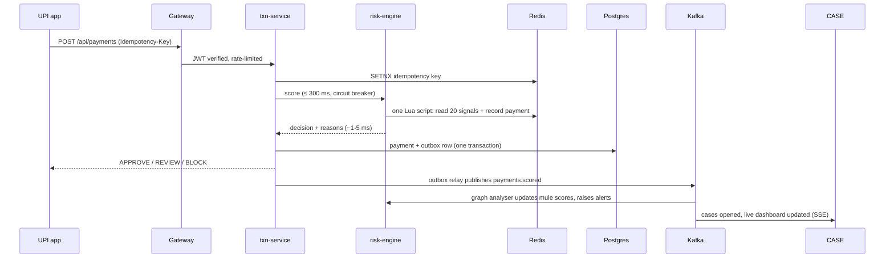

# FraudShield

**Real-time UPI fraud and money-mule detection, with an AI copilot for fraud investigators.**

FraudShield scores every UPI payment in a few milliseconds, *before* the money moves. It also spots the
mule networks that move stolen money around India, and gives investigators an AI assistant that writes
case briefs grounded in RBI and FIU-IND guidance, with citations.

`Java 21` · `Spring Boot 4` · `Spring Cloud Gateway` · `Kafka` · `Redis` · `PostgreSQL + pgvector` ·
`LangChain4j (RAG)` · `React 19` · `Docker` · `Kubernetes`

> **Who is this page for?** Everyone. Start with [The problem](#the-problem) and [Screens](#screens)
> for the product, [Run it](#run-it) and [How to test it](#how-to-test-it) to try it, and
> [How it works](docs/HOW-IT-WORKS.md) for the full walkthrough. Designers: see [For designers](#for-designers).

---

## The problem

Digital payments in India have exploded, and so has fraud:

- **Losses are rising fast.** RBI data shows cyber-fraud losses grew from ₹421 crore in FY23
  to ₹2,055 crore in FY24. The Home Ministry reported ₹22,845 crore lost to cyber criminals in 2024.
- **Money mules are the plumbing of almost every scam.** These are bank accounts that receive stolen money
  and pass it on within minutes. The CBI's Operation Chakra-V reportedly found over 8.5 lakh suspected
  mule accounts. The RBI built MuleHunter.AI to help banks find them.
- **New scams beat old rules.** In a "digital arrest" scam, the victim pays from their own phone, in their
  own city, to someone pretending to be from the CBI. Device and location checks all pass.
- **Investigators drown in alerts.** Every flagged payment has to be read, understood and reported to
  regulators on a deadline (an STR to FIU-IND within 7 working days).

## What FraudShield does

| For | What they get |
|---|---|
| **The customer** | Genuine payments go through instantly (99.7% approved). Suspicious ones are held for a quick re-confirmation instead of being lost. |
| **The bank's risk team** | Every payment is scored in about 5 ms with a plain-English reason ("₹74,000 vs a usual ₹356", "new phone, 1,750 km away"). Thresholds can be tuned live during a scam wave. |
| **Fraud investigators** | One case per suspicious account, a visual map of where the money went, and an AI copilot that drafts the investigation brief and answers "do we need to file an STR?" with sources. |
| **The model** | Every analyst verdict instantly deny-lists the fraudster and becomes training data. The model retrains itself and is only promoted if it beats the current one. |

### Screens

| Screen | URL | What you see |
|---|---|---|
| Landing page | `/` | The product story: a live scoring feed, the 5 ms scoring path, an animated mule ring, explainable reasons, the copilot and the architecture |
| Sign in | `/login` | Analyst or team-lead demo accounts, beside a live decision feed |
| Live monitor | `/app` | Payments per second, decision latency, money protected, a live payment feed, attack buttons (mule ring, account takeover, digital arrest, UPI ID probing) and an honest detection scoreboard |
| Cases | `/app/cases` | A prioritised queue with SLA timers, filters and search |
| Case detail | `/app/cases/{id}` | The payment network graph, the evidence, a timeline, verdict buttons and the AI investigator copilot |
| Try a payment | `/app/playground` | Send a payment yourself and see exactly why it was approved, held or blocked |
| Risk model | `/app/model` | Feature weights, AUC, recall and precision, a confusion matrix, retraining and live thresholds |
| Knowledge base | `/app/knowledge` | Ask a policy question and see how semantic and keyword search each ranked the sources |

---

## Architecture



### The life of one payment



## Engineering decisions (and why)

| Decision | Why |
|---|---|
| **Synchronous scoring with a hard 300 ms budget and a circuit breaker** (Resilience4j) | A payment cannot wait for a struggling dependency. If the risk engine is slow, the breaker opens and a fallback policy decides: small payments **fail open** (approve), large ones **fail closed** (hold). Decisions are marked `degraded`. |
| **Degraded payments are replayed into the feature store from Kafka** | Otherwise every outage punches a hole in customers' behavioural history and weakens scoring for days. |
| **The whole feature read *and* write is one Redis Lua script** | One network round trip per payment, and atomic: two concurrent payments from the same account can never both see a stale count. It uses sorted sets (velocity windows), HyperLogLog (distinct counterparties), Welford's online variance (usual amount) and first-seen hashes (devices and payees). |
| **Only approved payments teach the trusted profile** | Attempt signals (velocity, fan-in/out, money flows, probing, shared devices) record every try. The payer's usual amount, last location and known devices and payees are learned by a second script, and only from approved payments. Otherwise every blocked attack teaches the model that the attacker's phone, city and amount are normal: found in testing, when repeated stolen-phone attempts drifted from BLOCK to APPROVE. |
| **Logistic regression, not a black box** | Each feature's contribution is exactly weight × value. Every decision explains itself to the customer, the analyst and the regulator, with no separate explainer. |
| **Transactional outbox + `FOR UPDATE SKIP LOCKED` relay** | The payment row and its event commit together, so no lost events. Replicas relay in parallel without leader election. Consumers de-duplicate on `txnId`, giving at-least-once delivery with effectively-once processing. |
| **Idempotency keys in Redis** (plus a unique database constraint) | Mobile apps retry on flaky 4G. A customer must be charged once, and every retry gets the original answer back. |
| **Merchant-aware mule scoring** | Fan-in (many payers) is normal for a chai shop. It only counts when the account also behaves like a conduit (new, or forwarding money on). This negative control cut false positives from ~3% to 0.2% in testing. |
| **A "new device" stays new for 24 hours** | Takeovers drain an account in the minutes after a device is bound, not just on its first payment. This mirrors NPCI's cooling-period limits. |
| **Continuous training with champion/challenger** | Every analyst verdict becomes a label. The engine retrains in the background, and a model is promoted only if its AUC is no worse *and* its false-positive rate does not rise. Replicas hot-swap the model through Redis. |
| **Cost-sensitive class weights (√imbalance)** | Fully balancing a 2% fraud rate pushed false positives to 2.2%, meaning thousands of genuine customers blocked. √ weighting keeps recall gains at a ~0.4% false-positive rate. |
| **Hybrid RAG: pgvector + Postgres full-text, fused with Reciprocal Rank Fusion** | Semantic search understands "someone forwarding stolen money". Keyword search nails "STR", "FIU-IND" and "1930". RRF merges them by rank, so there are no incomparable scores to tune. It's all one SQL query in the database the service already uses. |
| **In-process embeddings** (all-MiniLM-L6-v2 on ONNX) | No per-query cost, no customer data leaving the bank, and retrieval keeps working if the LLM is down. |
| **Provider-agnostic LLM with a deterministic fallback** | Swap OpenAI-compatible APIs, Claude or a local Ollama model with one environment variable. Without one, the copilot still produces a cited brief from the retrieved playbooks. |
| **JWT verified once at the gateway** | Services receive identity as `X-User-*` headers (spoofed copies are stripped). A Kubernetes NetworkPolicy ensures only the gateway can reach them. |
| **Redis token-bucket rate limits per user, much tighter on `/api/copilot`** | LLM calls cost money, so a runaway client can't run up the bill. |
| **Every service declares every Kafka topic; broker auto-create is off** | This prevents a real race found in testing: a consumer that starts first auto-creates a 1-partition topic, and misses messages on the partitions added later. |

## Measured results (local run, synthetic traffic)

| Metric | Result |
|---|---|
| Risk-engine scoring time | ~1-5 ms (p50 ~1 ms); end-to-end decision p95 ~10 ms |
| Back-fill throughput | 8,000 payments (scored, persisted, published) in ~20-30 s on a laptop |
| Model after automatic retraining | ROC AUC 0.998, recall 98%, false-positive rate 0.4% on the hold-out set (recall was 74-80% before blocked attempts stopped teaching the trusted profile) |
| Live detection (simulator ground truth, ~10,500 genuine payments) | 99.7% of genuine payments approved; every mule-ring, account-takeover and digital-arrest payment held or blocked; most UPI-probing misses are the first ₹1 test payments |
| Analyst verdict to deny-list | Under 1 s (the next payment to the mule is blocked at 0.99) |

Attacks are synthetic, so the simulator knows the ground truth and the dashboard shows an honest
detection scoreboard. Misses are mostly the *first* step of an attack (the first ₹1 probe, the first
deposit into a brand-new mule account), which no system can tell apart from a genuine payment.

---

## Run it

Requirements: Docker with about 4 GB of memory for containers.

```bash
docker compose up --build        # first build takes a few minutes
open http://localhost:3001       # landing page; "Open the console" signs in (analyst / fraudshield)
```

On the **Live monitor**, press **Start traffic**. FraudShield first back-fills 30 days of history for
1,000 synthetic customers, then streams live payments. Use **Launch an attack** to inject a mule ring or
a digital-arrest scam, then open the case it creates.

**Optional: use a real LLM for the copilot.** Copy `.env.example` to `.env` and set `AI_PROVIDER`,
`AI_API_KEY` and `AI_MODEL`. Any OpenAI-compatible API works (for example Groq's free tier), as do
Anthropic Claude and a local Ollama model.

### Develop locally

```bash
docker compose -f docker-compose.infra.yml up -d      # Postgres, Redis, Kafka only
./mvnw package                                        # build + 31 tests (Testcontainers needs Docker)
java -jar services/risk-engine/target/risk-engine-1.0.0.jar     # :8082
java -jar services/txn-service/target/txn-service-1.0.0.jar     # :8081
java -Xmx512m -jar services/case-service/target/case-service-1.0.0.jar  # :8083
java -jar services/gateway/target/gateway-1.0.0.jar             # :8080
cd frontend && npm install && npm run dev                       # :5173, proxies /api to :8080
```

### Kubernetes

```bash
kubectl apply -k k8s/
```

The manifests include startup, readiness and liveness probes on Spring Boot's health groups, resource
requests and limits, HPAs on the payment hot path, PodDisruptionBudgets, non-root read-only containers,
NetworkPolicies and an nginx Ingress with SSE-friendly settings. In production, swap the bundled
Postgres, Redis and Kafka for managed services (RDS with pgvector, ElastiCache, MSK) or operators
(CloudNativePG, Strimzi).

## API (via the gateway)

| Method | Path | Purpose |
|---|---|---|
| `POST` | `/api/auth/login` | Get a JWT |
| `POST` | `/api/payments` | Submit a payment (`Idempotency-Key` header supported) |
| `GET` | `/api/payments/stats` | Decision counts and latency percentiles |
| `POST` | `/api/simulator/start` · `/stop` · `/inject/{scenario}` | Synthetic traffic and attacks |
| `GET` | `/api/stream/live` | Server-Sent Events: payments, new cases, KPIs every second |
| `GET` | `/api/cases` · `/api/cases/{id}` | Case queue and detail |
| `POST` | `/api/cases/{id}/assign` · `/notes` · `/resolve` | Investigation workflow |
| `POST` | `/api/copilot/cases/{id}/summary` | AI investigation brief with citations |
| `POST` | `/api/copilot/ask` | Policy Q&A grounded in the knowledge base |
| `GET` | `/api/kb/search?q=` | Hybrid retrieval with per-retriever ranks |
| `GET` | `/api/risk/model` · `POST /api/risk/model/train` | Model card and retraining |
| `GET/PUT` | `/api/risk/thresholds` | Live decision thresholds |
| `GET` | `/api/risk/graph/{vpa}` | Payment network around an account |

OpenAPI for the payment service: `/api/payments/docs`.

## Project layout

```
contracts/          Event and API records shared by the services (Kafka message schemas)
services/
  gateway/          Spring Cloud Gateway: routing, JWT, rate limiting
  txn-service/      Payment intake, idempotency, circuit breaker, outbox, traffic simulator
  risk-engine/      Lua feature store, explainable model, trainer, mule graph analyser, feedback loop
  case-service/     Case management, SSE live feed, auth, RAG copilot, knowledge base (src/main/resources/kb)
frontend/           React + TypeScript + Tailwind dashboard (nginx in production)
k8s/                Kustomize manifests
infra/              Database init scripts
docs/               How it works, testing guide
scripts/            End-to-end API smoke test
e2e/                Playwright browser tests (full user journeys, phone-width layout)
```

## How to test it

- **Automated:** `./mvnw verify` runs 31 tests, including Testcontainers integration tests against
  **real Redis** (the Lua feature script) and **real pgvector** (ingesting the knowledge base and
  checking that both keyword and paraphrase queries retrieve the right sections).
- **End to end:** with the stack running, `./scripts/smoke-test.sh` runs 16 checks: sign-in, traffic,
  approve and block decisions with reasons, idempotency, attacks opening cases, cited copilot briefs,
  hybrid search, the model card and rate limiting.
- **In a real browser:** with the stack running, `cd e2e && npm install && npx playwright install chromium && npm test`
  runs Playwright through the 17-step analyst journey: landing page, sign-in (including a wrong password), live stream, an attack, cases, the network graph, a cited copilot brief, stolen-phone and everyday payments, confirming fraud on a mule and seeing the next payment to it blocked, the model and the knowledge base. It also checks that no page scrolls sideways on a 390 px phone.
- **By hand:** [docs/TESTING.md](docs/TESTING.md) is a click-by-click script with what you should see,
  plus a resilience check that stops the risk engine mid-traffic.

CI runs the build, the tests, a frontend type-check build and Kubernetes manifest validation, then
publishes images to GHCR.

## For designers

- **Feel:** a security-operations console. Dark graphite surfaces, one signal colour, dense but calm
  layouts, hairline borders, monospace wherever the data is an identifier.
- **Palette:** background `#0a0c0f`, surfaces `#111418` / `#161a1f`, lines `#222830`, text `#e8eaed`,
  signal blue `#5b9bff` for actions and focus. Decision colours are reserved for decisions only:
  approve `#3ecf8e`, review `#f5b03d`, block `#ff6363`. Tokens are in `frontend/src/index.css`.
- **Type:** IBM Plex Sans for the interface, IBM Plex Mono for UPI IDs, codes, latencies and labels.
  Numbers use tabular figures.
- **Motion:** the landing page's scoring feed stamps a decision on each payment as it arrives; the mule
  ring forms and is flagged as you scroll; reason bars fill to their contribution. In the console, new
  payments flash in and the active nav item slides. Everything respects "reduce motion".
- **Explainability is the product:** every decision shows its top reasons in plain English and a
  contribution chart; every copilot answer shows numbered sources. Keep these visible.
- **Open design questions:** keyboard-first case triage, how to show confidence and uncertainty in the
  graph, and a customer-facing "we held this payment" screen.
- Components: `frontend/src/components/ui.tsx` (Button, Card, StatGrid, DecisionBadge, RiskBar, Logo),
  the graph in `GraphView.tsx`, the landing page in `frontend/src/landing/`. Run `npm run dev` in
  `frontend/` (set `API_TARGET=http://localhost:8081` to use the Docker stack's gateway).

## Honest limitations

- The LLM path was verified with a local Ollama model (qwen2.5:1.5b) answering policy questions with
  citations. On a CPU-only laptop a full case brief takes several minutes, so the copilot times out and
  uses its rule-based brief instead. Use a hosted model (Groq, OpenAI or Claude) for interactive speed.

- Traffic is synthetic. The attack patterns follow public reporting, but real fraud is more adaptive.
- The knowledge base summarises public regulations for demonstration. Verify against the official RBI,
  NPCI and FIU-IND texts.
- A single Kafka broker and a single Postgres instance with one database per service keep the demo light.
  The design assumes managed, replicated infrastructure in production.

## Sources

- RBI fraud statistics and MuleHunter.AI: [Business Standard](https://www.business-standard.com/finance/news/rbi-innovation-hub-develops-mulehunter-ai-to-combat-mule-account-frauds-124120601042_1.html), [Angel One summary of RBI data](https://www.angelone.in/news/market-updates/bank-frauds-in-india-triple-to-36-000-crore-how-steps-are-being-taken-to-tackle-the-surge)
- Mule account typologies: [Insolvency Tracker](https://insolvencytracker.in/2025/06/28/mule-account/)
- RBI Master Directions on Fraud Risk Management (2024): [Grant Thornton summary](https://www.grantthornton.in/globalassets/1.-member-firms/india/assets/pdfs/services/rbi-master-directions-on-fraud-risk-management.pdf)
- Customer liability circular (2017): [RBI](https://rbi.org.in/Scripts/PublicationsView.aspx?id=17754)
- STR timelines: [FIU-IND](https://fiuindia.gov.in/pdfs/downloads/Brochures%20on%20FIU.pdf)
- Payment-system design inspiration: [Uber: money movements with strong consistency](https://www.uber.com/blog/money-scale-strong-data/)
- Reciprocal Rank Fusion: Cormack, Clarke and Büttcher, SIGIR 2009
